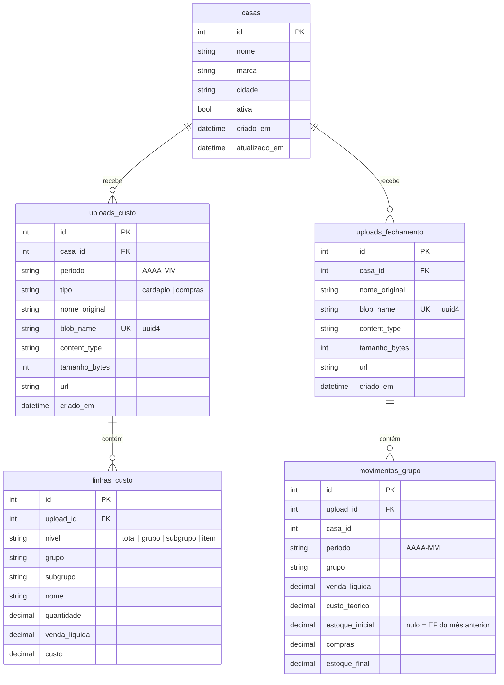

# Arquitetura

**IBM4028 — Projeto 4 | IBMEC CDIA 2026.2**

> **Estado em 19/11/2026.** Este documento descreve a aplicação **como ela está
> no ar hoje**, e é a referência técnica do relatório final (AP2). O que está
> aqui foi desenvolvido; o que não está ficou para as próximas ondas (seção
> "Fora da arquitetura atual"). A história de como se chegou aqui — o que
> entrou, saiu e por quê — fica nos outros documentos de `docs/`, que são
> mantidos como registro de época.

## Visão geral

```
                ┌──────────────────────────────┐
                │  Navegador (analista/sócio)  │
                └──────────────┬───────────────┘
                               │ HTTPS
                               ▼
┌──────────────────────────────────────┐        ┌─────────────────────────────────┐
│  Frontend — Azure Static Web Apps    │  HTTPS │  Backend — Azure App Service    │
│  React 19 + TypeScript + Vite        │  JSON  │  (Linux, Python 3.12, plano B1) │
│                                      ├───────►│  FastAPI + gunicorn/Uvicorn     │
│  6 abas: Casas · Upload ·            │◄───────┤                                 │
│  Fechar o mês · Fechamento ·         │  CORS  │  • rotas /api/v1 (Pydantic)     │
│  Margem por item ·                   │        │  • leitura das planilhas        │
│  Engenharia de cardápio              │        │  • regras de cálculo (services) │
└──────────────────────────────────────┘        │  • /health com SHA do commit    │
                                                └───────┬─────────────────┬───────┘
                                          SQLAlchemy    │                 │ azure-storage-blob
                                          (pyodbc/TDS)  ▼                 ▼
                                        ┌────────────────────┐   ┌────────────────────┐
                                        │  Azure SQL (Basic) │   │  Blob Storage      │
                                        │  casas, uploads,   │   │  container         │
                                        │  linhas, movimentos│   │  "uploads" (.xlsx) │
                                        └────────────────────┘   └────────────────────┘

  GitHub (main) ──► GitHub Actions ──► CI (ruff + pytest + build da imagem)
                                   ──► deploy do backend (OIDC) + verificação do /health
                                   ──► build e deploy do frontend (Static Web Apps)

  Observabilidade hoje: logs de aplicação e HTTP do App Service (ligados em
  06/11) e o /health registrado como health check. Application Insights não
  foi criado — ver "Fora da arquitetura atual".
```

Endereços em produção (também em `docs/01-requisitos.md`):

| | |
|---|---|
| Aplicação | https://zealous-river-0b6019910.6.azurestaticapps.net |
| API | https://app-projeto4-saints2026.azurewebsites.net |
| Documentação interativa | https://app-projeto4-saints2026.azurewebsites.net/docs |
| Health check | https://app-projeto4-saints2026.azurewebsites.net/health |

## Componentes e tecnologias

| Camada | Tecnologia (versão no lockfile) | Onde |
|---|---|---|
| Frontend | React 19, TypeScript 7, Vite 8, oxlint | `frontend/` |
| API | FastAPI 0.141, Pydantic 2.13, pydantic-settings | `app/` |
| Acesso a dados | SQLAlchemy 2.0 (síncrono), pyodbc 5.3 + ODBC Driver 18 no Azure | `app/database.py`, `app/crud.py` |
| Leitura de planilhas | openpyxl 3.1 | `app/services/leitores.py`, `leitor_fechamento.py` |
| Arquivos | azure-storage-blob 12.30 | `app/services/storage.py` |
| Servidor | gunicorn 26 + `UvicornWorker`, 2 workers | startup command do App Service; `Dockerfile` |
| Gerência de dependências | `uv` (lockfile `uv.lock` → `requirements.txt`) | raiz |
| Testes e lint | pytest + pytest-cov, ruff | `tests/`, `pyproject.toml` |
| Banco | SQLite local; Azure SQL tier Basic em produção | — |
| Nuvem | App Service B1, Azure SQL Basic, Storage Standard_LRS, Static Web Apps Free — região `centralus` | `infra/provisionar.sh` |

## Frontend

SPA sem roteador: `frontend/src/App.tsx` guarda a aba ativa em estado e
renderiza uma das telas de `frontend/src/screens/`. A casa e o período
escolhidos ficam no `App`, não em cada tela, para que trocar de aba não obrigue
a escolher a casa de novo.

| Aba | Tela | O que faz | Endpoints que chama |
|---|---|---|---|
| Casas | `Casas.tsx` | CRUD das unidades (RF08) | `/api/v1/casas` |
| Upload | `Upload.tsx` | Envio dos exports do Everest, lado teórico (cardápio) ou real (compras) — RF01 | `/api/v1/uploads-custo`, `/api/v1/modelos/{tipo}` |
| Fechar o mês | `FecharMes.tsx` | Fluxo guiado unidade → planilha-modelo → resultado (RF12) | `/api/v1/fechamentos`, `/api/v1/modelos/fechamento*` |
| Fechamento | `Fechamento.tsx` | CMV teórico × real, ajuste em pp, explicação por grupo (RF02/RF04/RF11), evolução e itens que mais pesam | `/api/v1/metricas/fechamento`, `/evolucao`, `/top-itens` |
| Margem por item | `MargemItens.tsx` | Itens que perderam margem contra um mês-base, em R$ (RF15) | `/api/v1/metricas/margem-itens` |
| Engenharia de cardápio | `Engenharia.tsx` | Matriz popularidade × margem por categoria (RF16) | `/api/v1/metricas/engenharia-cardapio` |

**Comunicação com a API** (`frontend/src/api.ts`): uma função `pedido<T>()`
centraliza o `fetch`. A URL base vem de `VITE_API_URL`, que é
`http://localhost:8000` em desenvolvimento (`frontend/.env.example`) e a URL do
App Service em produção, injetada no build pelo workflow do Static Web Apps.
Qualquer resposta fora de 2xx vira um `ApiError(status, detail)` com a mensagem
que a API devolveu em `detail`, e as telas mostram essa mensagem ao usuário.
Como a aplicação não tem autenticação, não há tratamento de 401/403.

## Backend

### Camadas

| Arquivo | Responsabilidade |
|---|---|
| `app/main.py` | Entrada, CORS, `include_router`, handler global de erro (stack trace no log, `{"detail": "Erro interno do servidor"}` na resposta) |
| `app/config.py` | `Settings` via `pydantic-settings` — nenhum segredo no código |
| `app/database.py` | Engine, `SessionLocal`, `Base`, `get_db`, `criar_tabelas()` no startup |
| `app/deps.py` | Aliases `Annotated`: `DbSession`, `AppSettings`, `PaginacaoDep` |
| `app/models.py` | Tabelas (SQLAlchemy) — como o dado é **guardado** |
| `app/schemas.py` | Contratos (Pydantic) — o que **entra e sai** da API |
| `app/crud.py` | Consultas e gravação; toda soma é `SUM`/`GROUP BY` no banco |
| `app/routers/` | Endpoints por domínio: `health`, `casas`, `uploads`, `fechamentos`, `metricas`, `modelos` |
| `app/services/` | Regras de negócio e integrações, sem rota e (quase sempre) sem banco |

### Serviços

| Módulo | Papel |
|---|---|
| `leitores.py` | Tradutores dos relatórios do Everest (engenharia de cardápio → lado teórico; DRE gerencial de compras → lado real) e da planilha genérica, todos para o formato único de `LinhaCusto` |
| `leitor_fechamento.py` | Lê a planilha-modelo de fechamento (venda, teórico e estoque por grupo, um ou vários meses) |
| `modelo_fechamento.py` | Gera a planilha-modelo `.xlsx` (abas Fechamento, Instruções, Conferência) |
| `explicacao.py` | RF11: decompõe o ajuste por grupo e escreve o resumo e até 2 sugestões, **por regras, sem LLM**; funções puras |
| `margem.py` | RF15: custo extra em R$ de cada item contra ele mesmo no mês-base |
| `engenharia.py` | RF16: matriz de Kasavana & Smith por categoria de cardápio |
| `demo_fechamento.py` | Estoque e compras simulados da casa de demonstração |
| `storage.py` | Grava no Blob Storage ou, sem connection string, em `./uploads_local/` |
| `previsao.py` | Previsão de demanda do RF07 — **legado**, ver abaixo |

### Endpoints

Todos sob `/api/v1`, exceto `/` e `/health`. Listagens são paginadas
(`limit`/`offset`). Não há autenticação: todo endpoint é público.

| Método e caminho | O que faz | Status |
|---|---|---|
| `GET /health` | Estado da API e do banco, versão, ambiente e **SHA do commit** publicado | 200 |
| `GET /` | Aponta para `/docs`, `/health` e o frontend | 200 |
| `GET /casas` · `GET /casas/{id}` | Lista (paginada) e detalha casas | 200, 404 |
| `POST /casas` | Cria casa | 201, 422 |
| `PATCH /casas/{id}` | Atualiza casa | 200, 404, 422 |
| `DELETE /casas/{id}` | Remove casa e, em cascata, seus uploads | 204, 404 |
| `POST /uploads-custo` | Recebe um export (`casa_id`, `periodo`, `tipo` = `cardapio`\|`compras`, arquivo `.xlsx`); reenviar o mesmo (casa, período, tipo) **substitui** o anterior | 201, 404, 413, 415, 422 |
| `GET /uploads-custo` | Lista uploads (paginada) | 200 |
| `POST /fechamentos` | Recebe a planilha-modelo de fechamento (um ou vários meses) | 201, 404, 413, 415, 422 |
| `GET /fechamentos` | Lista envios da planilha (paginada) | 200 |
| `GET /metricas/fechamento` | Fechamento do mês: total e grupos, `explicacao` (RF11), `base_real`, `acumulado` | 200, 404 |
| `GET /metricas/evolucao` | CMV teórico × real mês a mês | 200, 404 |
| `GET /metricas/top-itens` | Itens do cardápio que mais pesam no custo ou no CMV | 200, 404 |
| `GET /metricas/margem-itens` | Itens que perderam margem contra o mês-base (paginada) | 200, 404, 422 |
| `GET /metricas/engenharia-cardapio` | Quadrante de cada item por categoria (paginada) | 200, 404 |
| `GET /modelos/fechamento` | Baixa a planilha-modelo de fechamento | 200 |
| `GET /modelos/{tipo}` | Baixa a planilha-modelo genérica do lado teórico ou real | 200, 422 |
| `GET /modelos/fechamento/demo` · `/demo/planilha` · `/demo/cardapio` | Dados e planilhas da casa de demonstração | 200, 404, 422 |
| `GET /metricas/recomendacao-compra` | **Legado (RF07)**: rota mantida, sem tela desde 18/11 | 200, 404 |

O contrato completo, com os schemas de entrada e saída, está em `/docs`.

### Dois caminhos para o fechamento

A casa pode ser fechada de duas formas, e o cálculo escolhe sozinho
(`crud.usa_planilha_fechamento`):

```
Caminho Everest (RF01/RF02)                 Caminho planilha-modelo (RF12)
POST /uploads-custo  tipo=cardapio          POST /fechamentos
POST /uploads-custo  tipo=compras             → leitor_fechamento valida
  → leitores.ler() traduz o layout            → movimentos_grupo (grupo × mês)
  → linhas_custo (total/grupo/subgrupo/item)
            │                                          │
            └────────────► GET /metricas/fechamento ◄──┘
                 casa tem planilha? → crud._fechamentos_movimento
                 senão              → caminho Everest
                 → explicacao.explicar() (RF11) → FechamentoResponse
```

- **Everest:** o lado real é a DRE de **compras**, sem inventário
  (`base_real` = `compras`). É o que existe para a casa piloto.
- **Planilha-modelo:** traz estoque por grupo, então o lado real é o **CMV
  real**, EI + compras − EF (`base_real` = `consumo`). Estoque inicial em
  branco usa o estoque final do mês anterior, resolvido na hora do cálculo.

Regra completa do cálculo: `docs/07-fechamento-cmv.md`.

### Fluxo de um envio de arquivo

```
POST /api/v1/uploads-custo
  → casa existe? (404)
  → é .xlsx? (415)  → cabe no limite de MAX_UPLOAD_MB? (413)  → vazio? (422)
  → leitores.ler(): reconhece o layout ou recusa com a razão (422)
  → storage.salvar(): nome do blob = uuid4, nunca o nome do cliente
  → grava UploadCusto + LinhaCusto; apaga o upload anterior do mesmo
    (casa, período, tipo), se houver
  → 201 Created
```

## Dados



- **Unicidade:** um upload por (`casa_id`, `periodo`, `tipo`) em
  `uploads_custo`; um movimento por (`casa_id`, `periodo`, `grupo`) em
  `movimentos_grupo`. É o que faz o reenvio substituir em vez de duplicar.
- **Criação e evolução do esquema:** `criar_tabelas()` roda no startup
  (`Base.metadata.create_all`). A única migração até agora é
  `_migrar_uploads_sem_tipo()` (03/11/2026, do CSV fictício para `LinhaCusto`).
  Não há Alembic.
- **Dados iniciais:** a casa de demonstração, "Boteco Sao Bento - Demonstracao
  (DEMO)", é populada pela própria API com `scripts/popular_demo_fechamento.py`.
  O cardápio é copiado da casa piloto e o estoque e as compras são simulados.
  Nenhum dado do cliente fica no repositório: os testes usam
  `tests/planilhas.py` e `tests/sintetico.py`.

## Por que stateless

O App Service pode subir várias instâncias, e o gunicorn já roda 2 workers por
instância. Se o servidor guardar estado em variável global, a próxima
requisição cai em outro processo que não o conhece. O estado viaja na
requisição (id e período na URL) ou vai para o banco.

**Consequência prática:** nunca guarde nada em variável de módulo entre
requisições. A mesma razão explica o tratamento da corrida entre workers no
`criar_tabelas()` (`app/database.py`).

## Ambientes e configuração

| | Local | Azure |
|---|---|---|
| Banco | SQLite (`projeto4.db`) | Azure SQL Basic |
| Arquivos | `./uploads_local/` | Blob Storage, container `uploads` (soft delete ligado) |
| Configuração | `.env` (fora do Git; modelo em `.env.example`) | App Settings do App Service |
| Executar | `uv run fastapi dev app/main.py` · `npm run dev` em `frontend/` | gunicorn + `UvicornWorker`, 2 workers |
| CORS | `localhost:3000`, `localhost:5173` | hostname do Static Web App |

Variáveis lidas por `app/config.py` (só os nomes): `ENVIRONMENT`, `DEBUG`,
`DATABASE_URL`, `AZURE_STORAGE_CONNECTION_STRING`, `AZURE_STORAGE_CONTAINER`,
`CORS_ORIGINS`, `MAX_UPLOAD_MB`, `FRONTEND_URL`, `GIT_COMMIT`. No Azure, os
segredos (`DATABASE_URL`, `AZURE_STORAGE_CONNECTION_STRING`) ficam como App
Settings.

## Integração e entrega contínuas

| Workflow | Gatilho | O que faz |
|---|---|---|
| `.github/workflows/ci.yml` | push e PR em `main`/`develop` | `ruff check`, `ruff format --check`, `pytest` com cobertura; depois builda a imagem do `Dockerfile` e confere que o container sobe e responde no `/health` |
| `.github/workflows/deploy-azure.yml` | push em `main` | Job de testes (ruff + pytest) como **portão**: o deploy só roda com eles verdes. Login no Azure por **OIDC** (sem segredo de longa duração), `webapps-deploy`, grava `GIT_COMMIT` no App Settings, reinicia e exige que o `/health` devolva o SHA deste commit |
| `.github/workflows/azure-static-web-apps-*.yml` | push em `main` e PRs | Build do frontend com `VITE_API_URL` apontando para o App Service e publicação no Static Web Apps; PR gera ambiente de preview |

Verificação manual após cada deploy: `/health` com o SHA novo e o fechamento
de set/26 da casa piloto com `ajuste_pp: -3.68`.

## Segurança — o que existe

- Nenhum segredo no código ou no Git: `pydantic-settings` → `.env` local, App
  Settings no Azure; o deploy entra no Azure por OIDC.
- HTTPS obrigatório no App Service (`httpsOnly`), TLS 1.2 mínimo no Storage.
- CORS restrito ao domínio do frontend.
- Validação de toda entrada por Pydantic (422), tipo e tamanho de arquivo
  validados antes de chegar ao Blob (415/413).
- Nome do blob gerado com `uuid4`; o nome enviado pelo cliente é só metadado.
- Stack trace vai para o log; a resposta HTTP leva só uma mensagem genérica.
- Container roda como usuário sem privilégio (`appuser`, `Dockerfile`).

## Decisões tomadas

| # | Decisão | Alternativa descartada | Motivo |
|---|---|---|---|
| 1 | FastAPI | Flask, Django REST | Validação nativa, docs automáticos, exigência da disciplina |
| 2 | `uv` | venv + pip | Lockfile real, build reproduzível; `uv export` gera o `requirements.txt` do Azure |
| 3 | SQLAlchemy síncrono | SQLModel, driver async | Rotas viram `def` normal (threadpool), sem risco de bloquear o event loop |
| 4 | SQLite local, Azure SQL em produção | Azure SQL sempre | O time desenvolve e roda testes sem credencial nem custo |
| 5 | Blob Storage para arquivos | Coluna BLOB no banco | Binário em banco relacional é caro e não escala |
| 6 | Versionamento `/api/v1/` desde o dia 1 | Adicionar depois | Evoluir sem quebrar o frontend em produção; campos novos entram como opcionais |
| 7 | Paginação obrigatória em listagem; agregação no banco | Retornar tudo e somar em Python | Funciona com 50 linhas, derruba a instância com 500 mil |
| 8 | OIDC no GitHub Actions | Publish profile | Nenhum segredo de longa duração guardado no GitHub |
| 9 | Azure Static Web Apps para o frontend | Servir estático pelo próprio FastAPI | SPA + API separada; build e deploy próprios, CDN e certificado incluídos no Free |
| 10 | Branch padrão `main` | `master` | Os workflows assumiam `main`; renomear corrigiu um bug real (nada disparava) |
| 11 | Região `centralus`, plano **B1** | `brazilsouth`/`eastus`, plano F1 | As duas regiões estão bloqueadas pela política da assinatura; F1 sem capacidade em `centralus` |
| 12 | Tradutor por layout (`leitores.py`) para um formato único (`LinhaCusto`) | Uma tabela por relatório do ERP | O resto do sistema ignora o formato de origem; cruzar teórico × real vira um `GROUP BY` |
| 13 | Planilha-modelo de fechamento ao lado do Everest | Exigir só o export do ERP | O ERP não tem estoque; sem estoque o lado real é compras, não CMV real |
| 14 | Explicação do ajuste por regras (`explicacao.py`) | LLM | O texto precisa ser auditável e testável com números na mão; três ramos de sinal (acima/dentro/abaixo) |
| 15 | `/health` devolve o SHA do commit | `/health` só "ok" | Em 06/11 o deploy reportou sucesso com o código antigo no ar |
| 16 | Tabelas criadas no startup (`criar_tabelas`) | Alembic | Esquema pequeno e um só ambiente; Alembic fica para a próxima onda |
| 17 | Sem autenticação | JWT/Entra ID | Uso interno, uma casa piloto e dados sem informação pessoal; o ciclo priorizou o cálculo |

> Nova decisão relevante entra aqui, com a alternativa descartada e o motivo.

## Fora da arquitetura atual (próximas ondas)

O que **não** está na aplicação de hoje e fica para desenvolvimento futuro.
O motivo de cada item está em `docs/01-requisitos.md` e `docs/09-uso-da-nuvem.md`.

| Item | Situação |
|---|---|
| Autenticação e perfis de acesso | Não implementado; toda rota é pública |
| Application Insights, métricas e alertas | Não criado; só os logs do App Service |
| Key Vault e identidade gerenciada | Segredos em App Settings; Blob por connection string |
| Migrações versionadas (Alembic) | `criar_tabelas()` no startup |
| Baixar o arquivo original de um fechamento (RF14, por SAS) | Blob é só escrita |
| Gestão de pessoal (RF03, RF05) | Adiado |
| DRE consolidada (RF06), recomendação de compra na tela (RF07), anexo de nota fiscal (RF09), produto com foto (RF10), cronômetro (RF13) | Fora do escopo entregue; a rota do RF07 continua na API como legado |
